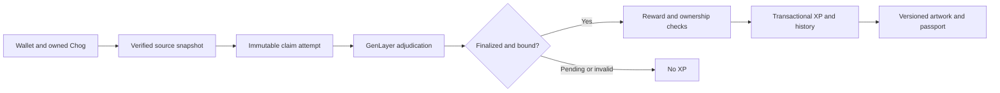
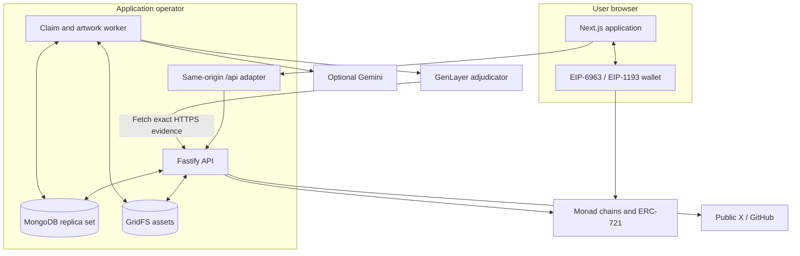
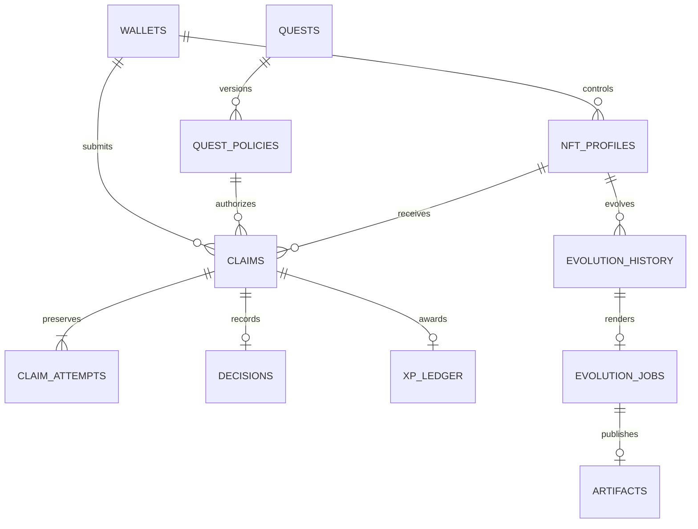
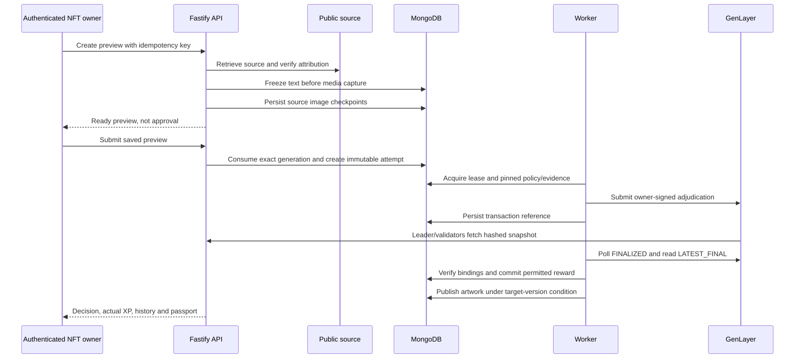
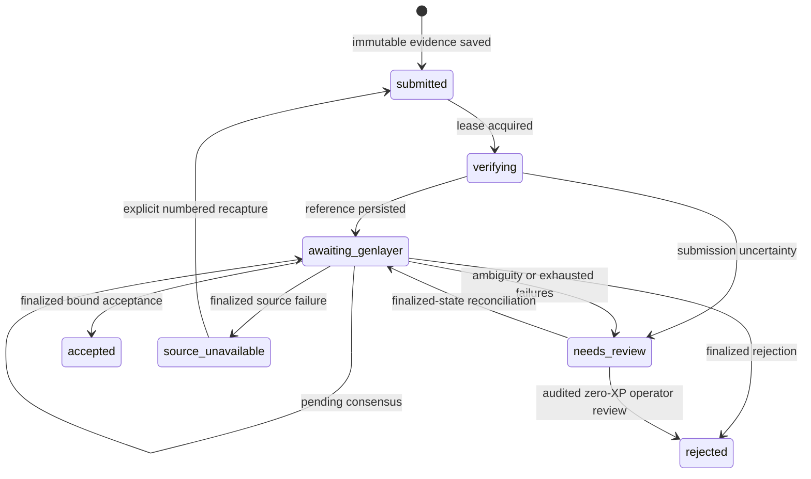

# CHOG Evolution

**Verified participation. Persistent NFT evolution.**

CHOG Evolution connects a Chog’s progression to verifiable activity in the Chog and Monad ecosystems. A wallet submits attributed evidence, GenLayer adjudicates it under a versioned policy, and a finalized, correctly bound decision can advance the NFT’s profile, traits and artwork.

[Launch the app](https://chog-evolution.vercel.app) · [Documentation](docs/README.md) · [Protocol specification](docs/protocol.md) · [API reference](docs/API.md) · [Deployment records](docs/deployment.md)

<p align="center">
  
</p>

## Contents

- [Statement of the problem](#statement-of-the-problem)
- [Design goals and acceptance criteria](#design-goals-and-acceptance-criteria)
- [What the MVP delivers](#what-the-mvp-delivers)
- [Protocol boundaries](#protocol-boundaries)
- [System architecture](#system-architecture)
- [Protocol specification](#protocol-specification)
- [Rewards and progression](#rewards-and-progression)
- [Networks and contracts](#networks-and-contracts)
- [Run locally](#run-locally)
- [Development and verification](#development-and-verification)
- [Repository map](#repository-map)
- [Contract interfaces and administrative powers](#contract-interfaces-and-administrative-powers)
- [HTTP API and client integration](#http-api-and-client-integration)
- [Artwork, equipment and metadata behavior](#artwork-equipment-and-metadata-behavior)
- [Operating and deploying the MVP](#operating-and-deploying-the-mvp)
- [Security assumptions and residual risks](#security-assumptions-and-residual-risks)
- [Development workflow and documentation maintenance](#development-workflow-and-documentation-maintenance)
- [Scope and extension points](#scope-and-extension-points)
- [Terminology](#terminology)
- [Release evidence and scope](#release-evidence-and-scope)

## Statement of the problem

An NFT can establish ownership without recording why its holder matters to an ecosystem.
A wallet may build a useful project, write an original contribution or use an ecosystem application,
yet the NFT usually has no persistent, attributable record of that participation.

A useful evolution system must answer more than “did the user paste a link?”
It must establish who submitted the source, which activity occurred, which rules applied,
whether adjudication finalized, whether a reward was already consumed and how the NFT changed.

### Fragmented evidence

Participation is distributed across EVM transactions, public social posts and code repositories.
Each source has different identity and availability rules.
A matching username is weaker than a stable verified account ID.
A transaction hash is insufficient without sender, receipt, network and canonical-block checks.
A wallet mentioned in a README is attribution evidence, not automatic proof of originality.

### Mutable sources and uncertain decisions

Public posts can change or disappear.
Repository branches can advance between capture and review.
An external validator cannot reliably review a moving source as if it were a fixed claim.
A successful transaction submission also does not establish finalized adjudication.

### Duplicate rewards and operational failure

Refreshes, retries, multiple NFTs and overlapping worker runs can repeat the same request.
A reward system that checks eligibility outside its transaction can spend one wallet allowance twice.
A worker can also crash after broadcast but before saving a network reference.
The system must preserve this uncertainty and reconcile it before another submission.

### Persistent identity and understandable outcomes

Owners need to distinguish an earned trait from an equipped trait.
They need to see pending review, rejection, accepted-without-XP and completed evolution separately.
They should be able to revisit a public passport and understand the source, decision and artwork history.
An original Chog should retain its original collection identity while a companion profile evolves.

### The implemented response

CHOG Evolution captures attributed evidence as immutable application snapshots,
pins policy and attempt identity, obtains finalized GenLayer adjudication,
enforces reward scopes transactionally and publishes versioned evolution history and artwork.

The MVP intentionally makes operator authority visible.
It does not describe its offchain ledger as a trustless onchain reward mechanism.

## Design goals and acceptance criteria

| Goal                         | Observable implementation outcome                                         |
| ---------------------------- | ------------------------------------------------------------------------- |
| Verify the claimant          | Exact signed challenge, single-use nonce and persistent session           |
| Verify NFT control           | Current `ownerOf` on the configured collection and chain                  |
| Preserve reviewable proof    | Frozen text, durable media checkpoints and an exact evidence digest       |
| Bind the decision            | Attempt, claimant, NFT, quest, policy and evidence match finalized state  |
| Prevent replayed XP          | Request/source/reward uniqueness plus one ledger entry per logical claim  |
| Preserve concurrent progress | Wallet allowance serialization and profile reads inside the transaction   |
| Recover interrupted work     | Saved receipt, claim attempts, submission references and expiring leases  |
| Preserve visual continuity   | Historical target snapshots, provenance and version-safe publication      |
| Explain limits honestly      | Partial scan coverage and separate fixture, persistence and live evidence |

These are review criteria for this implementation.
They are not claims of independent audit, universal Sybil resistance or uninterrupted provider availability.

## What the MVP delivers

- **Real minting:** a separate ERC-721 demo collection on Monad Testnet, with wallet confirmation, receipt verification and automatic profile registration.
- **Original Chog companions:** evolution profiles for owned original Chogs on Monad mainnet. Original collection metadata is read-only.
- **Attributed contributions:** public X posts from a verified account or public GitHub repositories with a pinned README and wallet attribution.
- **Finality-aware rewards:** immutable claim attempts, independently fetched evidence, strict decision binding and transactional duplicate prevention.
- **Persistent evolution:** five progression stages, earned traits, owner-controlled equipment, before/after history and a public passport.
- **Recoverable artwork:** durable PNG/JSON publication, recorded renderer provenance and version checks that prevent older jobs replacing newer artwork.

The app has separate home, mint, evolution, quests, activity, profile and upgrade journeys. A ready preview confirms source capture and attribution; it does not guarantee approval or XP.

## Protocol boundaries

| Layer                      | Authoritative state                                                                                     |
| -------------------------- | ------------------------------------------------------------------------------------------------------- |
| Monad                      | ERC-721 ownership, mint receipts and transaction evidence                                               |
| GenLayer                   | Finalized adjudication for a particular claim attempt and policy                                        |
| API and worker             | Authentication, source attribution, ownership checks, reward limits and execution of recorded decisions |
| MongoDB and GridFS         | XP ledger, evolution profiles, source snapshots, history and published assets                           |
| Renderer / optional Gemini | Artwork derived from recorded progression and equipment                                                 |

**This release is an operator-managed MVP.** XP, equipment and evolution history are application state in MongoDB; they are not written into the ERC-721 contract. The GenLayer adjudicator accepts submissions only from its deployment owner. Consensus does not remove trust in the backend’s evidence capture, database administration or reward enforcement. See the [trust model](docs/security.md) before integrating.

## Evidence → decision → evolution



Validators fetch the exact public HTTPS snapshot and check its SHA-256 digest. The worker waits for `FINALIZED`, reads `LATEST_FINAL` contract state and matches the attempt ID, wallet, NFT identity, quest, policy version and evidence hash. An accepted decision can still produce **zero XP** when the wallet has used its contribution allowance or ownership changed. [Complete lifecycle](docs/protocol.md).

## System architecture

### Components and deployment topology



The browser initiates wallet actions.
The API verifies authentication, ownership and source attribution.
The worker submits and reconciles claims, commits eligible progression and publishes artwork.
MongoDB holds durable protocol records; GridFS holds source images and generated artifacts.

In production, Next hosts Fastify behind `/api` through `app.inject`.
A standalone Fastify deployment is also supported.
The scheduled worker is a separate process; API requests do not run an adjudication loop.
See [architecture](docs/architecture.md) for the exact process and module boundaries.

### Runtime stack

| Area                | Technology                                      | Role                                                |
| ------------------- | ----------------------------------------------- | --------------------------------------------------- |
| Application         | Next.js App Router and React                    | Product routes and wallet-driven state              |
| HTTP service        | Fastify 5, Node.js 24                           | Request validation, sessions and domain endpoints   |
| EVM access          | viem and browser EIP-1193 providers             | Wallet requests, receipts, contract reads and scans |
| Persistence         | MongoDB and GridFS                              | Transactions, indexes, history and assets           |
| Adjudication        | GenLayer Intelligent Contract and stable SDK    | Finalized policy interpretation                     |
| Composition         | Shared deterministic SVG composition and Sharp  | Trait artwork and image validation                  |
| Optional generation | Google AI SDK / Gemini                          | Reward artwork presentation                         |
| Contracts           | Solidity, OpenZeppelin ERC-721, Foundry         | Demo mint and ownership                             |
| Acceptance          | Node test runner, Playwright and isolated Mongo | Behavior, persistence and browser evidence          |

Dependency versions come from the committed lockfile.
Changing a runtime or SDK version requires checking its API and finality behavior rather than assuming compatibility.

### Durable record model



The diagram shows logical relationships, not SQL foreign-key enforcement.
Profile control changes after onchain ownership verification.
A claim has multiple immutable attempts but at most one positive logical-claim XP entry.
An accepted zero-XP decision creates no reward history or artwork job.
Equipment history has its own source event and can exist without a claim.

| Record family       | Important content                                                           |
| ------------------- | --------------------------------------------------------------------------- |
| Authentication      | Nonces, session token digests and privately retained signed proofs          |
| Profiles            | NFT identity, owner association, XP, stage, equipment and version           |
| Quest policies      | Immutable rules, source review, evidence hosts and reward                   |
| Previews            | Capture intent, generation, eligibility, expiry and consumed claim          |
| Claims and attempts | Request identity, evidence digest, network references and prior revisions   |
| Decisions and XP    | Adjudication payload separately from the amount actually committed          |
| Evolution history   | Before/after snapshots and source/decision references                       |
| Jobs and artifacts  | Immutable target version, upload checkpoints, content hashes and provenance |
| Scans               | Bounded coverage, checkpoints and verified candidate events                 |
| Operations          | Audit events, shared quotas, aggregate metrics and schema markers           |

[MongoDB indexes](services/api/src/mongo.ts) enforce unique wallet, NFT, request, source, reward and publication scopes.
Those indexes are part of correctness, not optional tuning.

### Transaction boundaries

| Transaction           | Records that commit together                                                                         |
| --------------------- | ---------------------------------------------------------------------------------------------------- |
| Claim creation        | Claim, evidence, initial attempt, timeline/audit and matching preview consumption                    |
| Positive finalization | Decision, finalized claim/attempt, ledger, current profile, provenance, history and artwork snapshot |
| Equipment update      | Idempotent source event, equipment/version, history and deterministic artwork job                    |
| Artwork publication   | Artifact, history/job publication and conditional current profile artwork                            |

RPC reads, provider capture, GenLayer broadcasts and image generation occur outside MongoDB transactions.
An external side effect cannot be rolled back by a database transaction.
Unknown-reference recovery therefore reconciles finalized state instead of blindly broadcasting again.

### End-to-end contribution sequence



GenLayer independently retrieves the application snapshot.
It does not independently redo the API's original X/GitHub/RPC capture.
This distinction is central to the [security model](docs/security.md).

## Protocol specification

### NFT and claim identity

An NFT profile uses `mode`, chain ID, normalized collection address and decimal token ID.
The two modes are `demo` and `original_companion`.
The profile remains associated with the NFT when ownership changes.

The GenLayer profile identity is:

```text
chainId:lowercasedCollectionAddress:tokenId
```

A logical claim persists across retries.
Attempt 1 uses the logical claim ID as its contract claim ID.
Later attempts use `<claimId>:<attemptNumber>`.
Changing an attempt does not erase the earlier source or create another logical-claim reward.

### Separate version domains

| Domain                | Current representation                                                       |
| --------------------- | ---------------------------------------------------------------------------- |
| Progression policy    | `3`                                                                          |
| Trait catalogue       | `1`                                                                          |
| Database schema       | `3`                                                                          |
| Public claim evidence | `chog-evidence-v2`                                                           |
| Artifact metadata     | `chog-artifact-v2`                                                           |
| Quest policy          | Per-quest monotonically increasing version                                   |
| Profile evolution     | Per-profile version advanced by positive rewards/effective equipment changes |

These values describe different contracts.
A quest policy is not automatically version 3 just because progression policy is 3.
Migration retains old policy versions for submitted claims.

### Authentication

1. Request a supported-chain challenge for the wallet address.
2. Sign the exact five-minute message with the wallet.
3. The API verifies signature recovery and atomically consumes the nonce.
4. A seven-day HttpOnly session restores authenticated requests.
5. Privileged actions still verify current NFT ownership.

Production cookies are Secure and SameSite=Lax.
Signed proofs are retained privately; public evidence includes only verified provenance.
Signing in does not mint, transfer an NFT or award XP.

### Source-specific verification

| Source              | Required facts                                                                                      | Important limit                                                 |
| ------------------- | --------------------------------------------------------------------------------------------------- | --------------------------------------------------------------- |
| Demo mint           | Successful receipt, canonical block, expected collection, mint event, exact token and current owner | Testnet demonstration; not official mainnet mint                |
| X bio               | Unique challenge code in public bio and stable numeric identity                                     | Account control, not social engagement                          |
| X contribution      | Exact public post and author matching the verified identity                                         | Captured images are not interpreted                             |
| GitHub contribution | Public repository, pinned commit/README and claimant wallet attribution                             | Attribution is not automatic originality or approval            |
| Mainnet activity    | Successful outbound contract call, calldata, destination code and canonical receipt/block           | Generic participation, not a specific external campaign mission |

Sources are captured under fixed provider and resource boundaries.
User-written context is untrusted evidence.
A request cannot choose its own RPC facts, decision or XP amount.

### Evidence serialization

The API freezes its JSON text and computes:

```text
evidenceHash = "0x" + SHA256(UTF8(exactEvidenceText))
```

The envelope records schema, kind, wallet, NFT identity, policy ID/version,
ownership-check time, public authentication provenance and verified source facts.
Contribution context is explicitly `user_context_untrusted`.

The public response is `text/plain; charset=utf-8` containing exact JSON.
Validators hash the body they fetch from the HTTPS evidence endpoint.
Clients must not parse and reserialize evidence before comparing its digest.

| Limit                     |     Current value |
| ------------------------- | ----------------: |
| API evidence snapshot     | 19,500 characters |
| Contract evidence text    | 20,000 characters |
| Contract combined rules   |  4,000 characters |
| Contract HTTPS source URL |  2,048 characters |
| Public JSON request body  |      65,536 bytes |

The application leaves room below contract limits and validates submission bounds before broadcast.
A publicly reachable HTTPS evidence URL is required for real external adjudication.

### Preview and claim lifecycle



Preview capture persists text before media and expires after ten minutes.
Partial media work resumes the saved revision.
Expired recapture creates a new generation.
Claim creation consumes a preview only if its owner, policy, generation and source digest still match.

### Finality and binding rules

The worker does not award from an `ACCEPTED` GenLayer proposal.
It waits for `FINALIZED`, rejects explicit execution failure and reads `LATEST_FINAL`.

| Decision field     | Must match                                               |
| ------------------ | -------------------------------------------------------- |
| `claim_id`         | Current immutable contract attempt                       |
| `claimant`         | Normalized submitting wallet                             |
| `profile_identity` | Configured NFT identity string                           |
| `quest_id`         | Stored quest                                             |
| `policy_version`   | Pinned rules                                             |
| `evidence_hash`    | Exact attempt digest                                     |
| `outcome`          | One of four supported outcomes                           |
| `reason`           | Nonempty explanation                                     |
| `xp`               | Accepted equals policy reward; other outcomes equal zero |

The supported contract outcomes are `accepted`, `rejected`, `needs_review` and `source_unavailable`.
A malformed or partially awarded accepted result fails the worker's exact-reward binding.
No positive XP is committed until every required condition passes.

### Adjudication versus actual award

An accepted contribution can produce zero XP because the daily allowance or cooldown is exhausted.
Ownership changes before finalization can also prevent a reward.
The public claim shows the decision outcome, `xpAward` and reward reason separately.

For contributions, the UTC day is the **finalization date**.
For mainnet participation, it is the **transaction block date**.
These scopes must not be interchanged.

A rewarded contribution at 23:30 UTC prevents another at 00:05 UTC.
The next eligible time is 00:30 UTC because the one-hour cooldown spans midnight.

### Replay protection and retry semantics

| Protection                  | Scope                                      |
| --------------------------- | ------------------------------------------ |
| Idempotency                 | Wallet, key and stable request intent      |
| Contribution source         | Global X post/repository identity          |
| Once-only rewards           | Wallet/quest and stable X identity         |
| Mainnet daily participation | Wallet and UTC block date                  |
| Contribution allowance      | Wallet across all profiles at finalization |
| XP commit                   | Unique logical claim                       |
| Evolution/publication       | Unique claim or equipment source event     |

Source uniqueness is consumed at claim creation.
A rejected or zero-XP source cannot be made eligible by changing wallet, profile or quest.
Changing a repository commit does not create a fresh repository contribution.

Pending consensus schedules polling and does not spend provider-failure retries.
A finalized source-unavailable claim can explicitly recapture the same source into a numbered attempt.
A rejection is terminal.
An unknown submission reference requests finalized-state reconciliation; it is not permission to rebroadcast.

### Concurrency and ownership transfer

Positive contributions serialize allowance on the wallet document inside the transaction.
Profile XP is reread inside finalization, avoiding stale worker snapshots.
Equipment uses `expectedVersion`.
Artwork publication checks the target profile version.

A transferred NFT retains its profile and history.
The new owner must sign in and pass current onchain ownership checks.
Existing wallet reward scopes do not reset with the transfer.
An ownership RPC read and database commit are separate operations, so there is no cross-system atomic ownership lock.

## Rewards and progression

Current progression policy: **3**. Trait catalogue: **1**. Individual quest policy versions are stored separately and increase when their definitions change.

| Maintained quest          | Maximum positive reward | Reward boundary                                                                                  |
| ------------------------- | ----------------------: | ------------------------------------------------------------------------------------------------ |
| First demo mint           |                   50 XP | Once per wallet                                                                                  |
| Verified X bio            |                   50 XP | Once per wallet; stable X identity cannot move to another wallet                                 |
| Ecosystem contribution    |                   75 XP | One rewarded contribution per wallet per UTC finalization day; one-hour cooldown across midnight |
| Monad mainnet interaction |                   25 XP | Once per wallet per UTC date of the transaction’s block                                          |

| Stage     | Minimum XP | Trait earned                       |
| --------- | ---------: | ---------------------------------- |
| Hatchling |          0 | Base Chog                          |
| Curious   |         50 | Bright eyes, a fixed stage feature |
| Explorer  |        150 | Trail scarf, optional accessory    |
| Veteran   |        350 | Star crown, optional accessory     |
| Legend    |        700 | Comet glow, optional aura          |

The scarf and crown share one equipment slot. New optional traits unlock without automatically equipping. Equipment changes create history and artwork without awarding XP. [Policy and evidence requirements](docs/quest-registry.md).

## Networks and contracts

| Network                     | Purpose                           | Address / record                                                                                                                                                              |
| --------------------------- | --------------------------------- | ----------------------------------------------------------------------------------------------------------------------------------------------------------------------------- |
| Monad Testnet, `10143`      | CHOG Evolution Demo (`DCHOG`)     | [`0x45119A32ca6C4d67424401dA92Abe4EC6c83f8Ce`](https://testnet.monadscan.com/address/0x45119A32ca6C4d67424401dA92Abe4EC6c83f8Ce) · [manifest](deployments/monad-testnet.json) |
| Monad mainnet, `143`        | Original Chog companion ownership | [`0xc96d31F8626c6D03Fae5dCD3d61e3FB9F4a73763`](https://monadscan.com/address/0xc96d31F8626c6D03Fae5dCD3d61e3FB9F4a73763)                                                      |
| GenLayer StudioNet, `61999` | Claim adjudicator                 | `0x73Bd1106FFa722cf8e71A04f612ee868CDCd2396` · [manifest](deployments/genlayer-studionet.json)                                                                                |

These are recorded deployment identities. Operators must verify the configured network, bytecode/schema and owner before using a signer. The demo contract has a 10,000-token cap and a zero-value mint; the wallet pays network gas. Its owner can update the collection-wide metadata base URI. [Solidity contract](contracts/README.md) · [GenLayer contract](genlayer/README.md).

## Run locally

Requirements: **Node.js 24**, **npm 11+**, and a transaction-capable **MongoDB replica set** or Atlas deployment. Docker is the supplied local database option. Full release checks additionally require Foundry, Python 3.11+ and `genvm-linter==0.11.0`.

```sh
git clone https://github.com/TS-mfon/chog-evolution.git
cd chog-evolution
cp .env.example .env
npm ci
docker compose up -d --wait mongodb
npm run db:migrate
npm run dev
```

The repository currently requires GitHub access. Before migrating, review `.env`: use your own database, set the correct browser/evidence origins and configure integrations for your environment. Open [localhost:3000](http://localhost:3000); the web’s API is `/api`, and readiness is `/api/ready`. Root development and migration commands load `.env` automatically. In an already configured shell, `npm run db:migrate --workspace=@chog/api` is also available.

Local source capture and UI development can run without a GenLayer signer. Real external adjudication needs a publicly reachable HTTPS evidence API and a funded signer that owns **your configured adjudicator**. An arbitrary key cannot submit to the recorded deployment. [Complete setup](docs/setup.md) · [Configuration reference](docs/configuration.md).

## Development and verification

| Command                                 | Purpose                                                                     |
| --------------------------------------- | --------------------------------------------------------------------------- |
| `npm run dev`                           | Web, standalone API and continuous development worker                       |
| `npm run build`                         | Build API, worker and web                                                   |
| `npm run check`                         | Type-check all workspaces                                                   |
| `npm test`                              | Unit and provider/recovery behavior checks                                  |
| `node scripts/verify-project-docs.mjs`  | Documentation links and implementation consistency                          |
| `node scripts/verify-mvp.mjs`           | Production build, route checks, types, Solidity, GenVM and reference hashes |
| `npm run test:integration`              | Actual isolated MongoDB transactions and recovery                           |
| `npm run test:browser:all`              | Fixture UI acceptance and browser through actual API/Mongo/GridFS           |
| `npm run once --workspace=@chog/worker` | One bounded worker tick, after building and loading its environment         |
| `npm run metadata:check`                | Read-only inspection of the deployed demo metadata configuration            |

Persistence suites require an isolated `MONGODB_TEST_URI` in ignored `.env.integration`; browser suites require a build and Chromium. Fixture tests do not establish live provider availability. [Verification guide](docs/testing.md).

## Repository map

```text
apps/web/                   Next.js application and same-origin API adapter
services/api/               Fastify, auth, evidence, ownership and repositories
services/evolution-worker/   GenLayer reconciliation and artwork publication
packages/evolution-rules/    Reward allowance, stages and trait catalogue
packages/art-composition/    Deterministic Chog composition
packages/shared-types/      Shared domain types
packages/validation/        Shared validators
contracts/                  DemoChog Solidity source and Foundry tests
genlayer/                   Owner-gated Intelligent Contract
deployments/                Contract and metadata deployment manifests
docs/                       Protocol, integration and operator documentation
scripts/                    Deployment and acceptance tooling
assets/chog-references/     Versioned visual reference assets
```

## Contract interfaces and administrative powers

### DemoChog on Monad Testnet

```solidity
function mint() external returns (uint256 tokenId);
function setBaseURI(string calldata newBaseURI) external;
function nextTokenId() external view returns (uint256);
function maxSupply() external view returns (uint256);
function ownerOf(uint256 tokenId) external view returns (address);
function tokenURI(uint256 tokenId) external view returns (string memory);
```

The Solidity contract uses OpenZeppelin ERC-721 and Ownable.
Token numbering starts at 1.
Minting is permissionless and nonpayable; the contract enforces its immutable supply cap.
The owner can change the collection-wide base URI and use inherited ownership management.

It does not store XP, quest policies, equipment or GenLayer decisions.
The API's dynamic metadata view supplies the demo's evolution presentation.
See [contract reference](contracts/README.md) for tests and deployment verification.

### ClaimAdjudicator on GenLayer

```text
adjudicate(
  claim_id,
  claimant,
  profile_identity,
  policy_version,
  quest_id,
  rules,
  source_url,
  evidence_text,
  evidence_hash,
  max_xp
)
get_claim_decision(claim_id)
```

Only the deployment owner can submit.
The contract rejects reused claim IDs, invalid policy bounds and mismatched evidence hashes.
Leader and validators fetch the exact snapshot and compare outcome, quest, digest and XP.
Reason wording may differ while decision-bearing fields agree.

The contract stores adjudication; it does not mint, transfer or apply XP.
No owner-transfer method is exposed in this GenLayer source.
See [GenLayer reference](genlayer/README.md) before changing a signer or deployment.

## HTTP API and client integration

### Base paths and credentials

The unified deployment uses `https://chog-evolution.vercel.app/api`.
Standalone Fastify paths omit the `/api` prefix.
Authenticated wallet calls use the `chog_session` cookie and browser requests need `credentials: "include"`.

Admin operations instead require the server-configured `X-Quest-Admin-Key`.
Policy creation and manual review also require an `X-Admin-Actor` audit label.
These credentials must not be included in a public client bundle.

### Principal endpoint groups

| Group                  | Representative routes                                                     |
| ---------------------- | ------------------------------------------------------------------------- |
| Health / configuration | `GET /health`, `GET /ready`, `GET /v1/config`                             |
| Authentication         | `POST /v1/auth/nonce`, `POST /v1/auth/verify`, `GET /v1/auth/me`          |
| Mint                   | `POST /v1/mints/prepare`, `POST /v1/mints/confirm`                        |
| Profiles               | `POST /v1/profiles/discover`, `GET /v1/profiles`, `GET /v1/passports/:id` |
| Equipment              | `GET /v1/traits`, `PATCH /v1/profiles/:id/traits`                         |
| X identity             | `POST /v1/social/x/challenge`, `POST /v1/social/x/verify`                 |
| Evidence               | `POST /v1/evidence/previews`, `GET /v1/evidence/:id`                      |
| Claims                 | `POST /v1/claims`, `GET /v1/claims/:id`, `POST /v1/claims/:id/retry`      |
| Contribution           | `POST /v1/upgrades/evidence`                                              |
| Mainnet scan           | `POST /v1/scans`, `GET /v1/scans/:id`                                     |
| Metadata / assets      | `GET /v1/metadata/demo/:tokenId`, `GET /v1/artifacts/:id`                 |
| Operations             | `GET /v1/admin/metrics`, reviewed policy and claim administration         |

The [API reference](docs/API.md) specifies request fields, response shapes,
authentication, status codes, pagination and retry rules for the maintained routes.

### Idempotent submission pattern

Generate a key once for a user intent and preserve it through network retries.
Reuse that key with the same body.
If the intent changes, create a new key.
Do not generate a new key automatically after an uncertain submission response.

```javascript
const response = await fetch("/api/v1/upgrades/evidence", {
  method: "POST",
  credentials: "include",
  headers: {
    "Content-Type": "application/json",
    "Idempotency-Key": savedRequestKey,
  },
  body: JSON.stringify({
    profileId: selectedProfile.id,
    previewId: readyPreview.id,
  }),
});
const result = await response.json();
```

This example uses values obtained from the authenticated API.
An HTTP 202 means accepted for processing or still pending; it is not a positive reward.
Read the persisted claim and its timeline to determine the actual result.

### Error and pagination contracts

JSON errors have `error`, `message`, `requestId` and `retryable`.
The response also includes `X-Request-Id`.
A 429 supplies `Retry-After`; retry the same intent only after its delay.
A stale equipment version or idempotency conflict needs reconciliation, not blind repetition.

Collections normally accept `limit` from 1 to 100, default 25, and an opaque `cursor`.
They return `items` and `nextCursor`.
Keep cursors unchanged and scoped to their original endpoint/owner.
Discovery and passport history have separate cursor formats.
A filtered empty page can still have a next cursor.

## Artwork, equipment and metadata behavior

### Earned traits versus equipped traits

Stage features preserve the Chog's identity.
Optional traits enter the earned inventory when progression reaches their threshold.
Unlocking an optional trait does not automatically change the owner's chosen equipment.

The trail scarf and star crown share an accessory slot.
Comet glow uses the aura slot.
The owner can equip, replace or remove earned optional traits without XP changes.
Each effective equipment change records its own history and artwork snapshot.

### Publication and provenance

Reward state commits before image generation.
Jobs render the immutable evolution snapshot rather than reading a later profile as their target.
Images and JSON record source event, profile version, content hashes and renderer provenance.

Without a Gemini key, reward images use deterministic composition.
Configured Gemini failures retain existing art and retry.
Equipment images always use the deterministic renderer.
A completed older job can enrich history without replacing newer current artwork.

### Metadata authority

Demo token URIs resolve through the owner-configurable collection base URI.
The API verifies token existence before returning dynamic ERC-721 metadata.
Published asset URLs are immutable; the dynamic token metadata is short-cached.

Original Chog metadata is read-only and stored separately from companion art.
A failed refresh preserves the last valid metadata and exposes an unavailable/error state.
Companion evolution never implies that the original collection was modified.

## Operating and deploying the MVP

### Local versus public adjudication

Local MongoDB and UI development work through the supplied environment and Compose setup.
An external GenLayer validator cannot fetch localhost.
Use a deployed HTTPS API or your own public development origin for real adjudication.
The signer must own the configured adjudicator; copied public addresses do not grant ownership.

### Production processes

The Vercel workflow installs the lockfile, runs release/persistence/browser checks,
applies explicit migrations, configures runtime variables, deploys and smoke-tests readiness/quests.
The GenLayer deployment workflow is manually dispatched.
The evolution worker workflow is scheduled and supports manual dispatch.

The worker tick processes a bounded capture batch, claim batch and one artwork job.
Database leases coordinate execution when invocations overlap.
GitHub scheduler delays and provider latency mean five minutes is a schedule, not a finality SLA.

### Configuration boundaries

| Variable group                                 | Purpose                                              |
| ---------------------------------------------- | ---------------------------------------------------- |
| `MONGODB_URI`, `MONGODB_DATABASE`              | Durable application database and transaction support |
| `APP_ORIGIN`, `WEB_ORIGIN`, `PUBLIC_API_PATH`  | Evidence base, browser origin and API mount          |
| Monad RPC / collection variables               | Allowed chain identities and source verification     |
| `GENLAYER_*`                                   | Worker network, contract and owner signer            |
| `X_SOURCE_MODE`, optional provider read tokens | Source availability and public lookup limits         |
| `GEMINI_API_KEY`, `GEMINI_IMAGE_MODEL`         | Optional reward image generation                     |
| `QUEST_ADMIN_API_KEY`                          | Operator policy/review/metrics access                |
| Worker / scan limits                           | Bounded execution and coverage                       |
| `MONGODB_TEST_URI`                             | Isolated persistence acceptance server               |

[Configuration reference](docs/configuration.md) distinguishes consumed settings from reserved fields.
Server secrets must remain outside browser-visible `NEXT_PUBLIC_*` values.

### Health, readiness and observability

`/health` verifies that the process can answer.
`/ready` checks MongoDB and the current schema marker.
Neither proves that GenLayer is progressing, a signer is funded or an image quota is available.

Admin metrics expose bounded request/provider/job aggregates, queue age and overdue leases.
Use those with saved attempt references and workflow results to diagnose progress.
[Operator runbook](docs/operations.md) describes the recovery procedures.

### Failure recovery matrix

| Observation                  | Required response                                                           |
| ---------------------------- | --------------------------------------------------------------------------- |
| Mint receipt pending         | Recheck the saved hash; do not mint again                                   |
| Ready preview expired        | Explicitly recapture into a fresh generation                                |
| Partial source images        | Resume saved source checkpoints                                             |
| Consensus pending            | Poll the saved reference; keep XP unchanged                                 |
| Submission reference unknown | Read finalized state by attempt ID; do not rebroadcast                      |
| Finalized source unavailable | Explicit numbered recapture of the same logical source                      |
| Rejected contribution        | Preserve terminal result; do not bypass source uniqueness                   |
| Accepted with zero XP        | Read reward reason and allowance/ownership state                            |
| Stale equipment version      | Reload profile and resolve the intended change                              |
| Image provider failure       | Preserve reward and prior art; retry the existing job                       |
| Older artwork completes      | Retain historical publication; enforce current-version condition            |
| Database restore             | Restore all domain/GridFS records and reconcile before restarting execution |

### Persistence and backup

MongoDB must support transactions.
Migrations establish correctness indexes and retained historical policy/proof relationships.
Cold starts do not migrate the database.
The worker does not automatically reconcile a partially restored database.

Back up policies, claims/attempts/evidence, decisions, XP, profiles, history, jobs and GridFS together.
Restore into an isolated environment with execution stopped.
Verify indexes, references and artifact bytes before allowing submissions or rewards.
Hashes detect mismatched bytes but cannot reconstruct lost data.

## Security assumptions and residual risks

### Operator-managed authority

The adjudicator owner chooses submitted evidence and rules.
Database administrators control offchain progression and storage.
The demo contract owner can change metadata hosting for all demo tokens.
The shared admin key authorizes policy versions and zero-XP rejection; it is not decentralized governance.

### Controls implemented in this release

- Exact signed challenges and single-use nonce consumption.
- Current NFT ownership verification at mutation and finalization boundaries.
- Public/private evidence separation and normalized safe errors.
- Fixed provider URL boundaries with bounded source/media retrieval.
- Explicit treatment of source and user context as untrusted input.
- Finalized contract reads and complete decision binding.
- Request/source/reward uniqueness and transactional contribution allowance.
- Version checks for equipment and current artwork publication.

### Limits that remain visible

Consensus over an API snapshot does not independently prove original-source capture.
A wallet-attributed README is not a cryptographic repository-owner signature.
Stable X bindings do not establish one-human-one-wallet identity.
Provider outage, RPC failure and scheduler latency can delay progress.
Offchain state and metadata hosting remain dependent on the operator.

No independent audit, full SIWE conformance or universal prompt-injection resistance is claimed.
The [security model](docs/security.md) specifies CSRF/cookie assumptions,
signer rotation limits, public retention and ownership-read race boundaries.
Use [SECURITY.md](SECURITY.md) for private vulnerability reporting.

## Development workflow and documentation maintenance

1. Read the [protocol specification](docs/protocol.md) before changing reward or evidence behavior.
2. Use an isolated database and the committed npm lockfile.
3. Run targeted meaningful checks for the changed subsystem.
4. Update API, protocol and configuration references when their contracts change.
5. Complete the required release checks before a deployment.
6. Review migration and pending-claim compatibility when policy or contract identity changes.

The documentation verifier checks internal links, maintained route coverage,
configuration/deployment references and README coverage.
It is a consistency check, not an oracle for all prose or a security audit.

The [contribution guide](CONTRIBUTING.md) covers review expectations and licensing.
No project-wide LICENSE is currently present; a Solidity SPDX header does not license every asset.
Supplied Chog references and the local font retain separate provenance/license records.

## Scope and extension points

| Capability                                 | Current status / boundary                                                |
| ------------------------------------------ | ------------------------------------------------------------------------ |
| Demo ERC-721 mint                          | Implemented on Monad Testnet                                             |
| Original Chog companions                   | Implemented with read-only original metadata                             |
| X bio and submitted posts                  | Implemented; provider availability remains external                      |
| GitHub README contributions                | Implemented with pinned capture and wallet attribution                   |
| Recent mainnet participation               | Implemented bounded RPC scanning                                         |
| Reviewed event targets                     | Configurable; policy and completion signal require review                |
| GenLayer claim adjudication                | Implemented owner-signed, finality-aware workflow                        |
| Trait equipment and history                | Implemented with versioned deterministic jobs                            |
| Optional Gemini                            | Implemented adapter; successful live generation requires available quota |
| Arena, crafting and broad social ingestion | Outside this MVP                                                         |
| Mainnet demo mint and `$CHOG` issuance     | Outside this MVP                                                         |
| Onchain progression commitment             | Not implemented in this release                                          |

Extension points are not promises of a future release.
A new source needs attributed capture, bounded retrieval and an immutable evidence representation.
A new quest needs reviewed completion rules and reward scope.
A new renderer must consume authoritative state without changing reward semantics.

## Terminology

| Term               | Meaning                                                                          |
| ------------------ | -------------------------------------------------------------------------------- |
| Profile            | Persisted evolution state for one configured NFT identity                        |
| Companion          | Evolution state associated with an original NFT without modifying its collection |
| Claim              | Logical request for policy review                                                |
| Attempt            | Immutable evidence revision for a claim                                          |
| Policy             | Versioned eligibility, evidence and reward rules                                 |
| Finalized          | GenLayer consensus result read from finalized state                              |
| Accepted           | Adjudication outcome, distinct from actual XP                                    |
| Reward scope       | Identity/date boundary that prevents repeated awards                             |
| Source event       | Unique claim evolution or equipment change driving history/artwork               |
| Provenance         | Stored source/decision/renderer identity and content hashes                      |
| Passport           | Public profile and evolution history                                             |
| Immutable snapshot | Application-preserved revision; privileged storage remains operator-controlled   |

## Release evidence and scope

The [MVP release record](docs/mvp-release.md) contains dated production mint, finalized 50 XP reward, GridFS publication and deployment evidence. Published artwork in that record uses `chog-trait-renderer-v2`. Gemini generation remained quota-blocked in the recorded run; configuring a key is not proof of successful generation. Original metadata fetches can remain unavailable while the companion profile preserves its last valid state.

The scanner reports a bounded recent RPC window, not lifetime account history. Arena, crafting, broad social ingestion, a mainnet mint and a `$CHOG` token are outside this release. No external campaign is activated without reviewed rules and a verifiable completion signal.

[Contribute](CONTRIBUTING.md) · [Report a vulnerability](SECURITY.md) · [Operator runbook](docs/operations.md) · [Implementation ledger](docs/implementation-checklist.md) · [Original product plan](build-plan.md)
