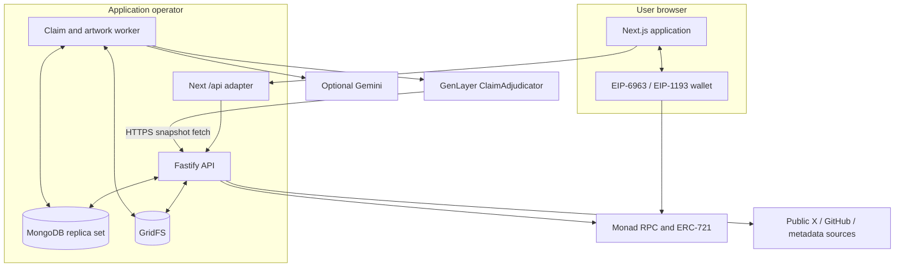

# Architecture

CHOG Evolution is a TypeScript monorepo with a Next.js client, Fastify API, MongoDB/GridFS and a separate GenLayer/artwork worker. Monad supplies NFT ownership and transaction facts; GenLayer supplies finalized adjudication. Progression is persisted offchain.

[Protocol specification](protocol.md) · [Trust model](security.md) · [Operator runbook](operations.md)

## System topology



The diagram describes communication, not a common trust domain: the browser, original providers, RPC, consensus network and operator-controlled storage each have different authority.

## Deployable processes

| Process  | Runtime                                       | Responsibility                                                                                            |
| -------- | --------------------------------------------- | --------------------------------------------------------------------------------------------------------- |
| Web      | Next.js App Router, Node 24 for server routes | Product routes, wallet discovery, client state and same-origin API transport                              |
| API      | Fastify 5 on Node 24                          | Authentication, ownership, policies, source capture, preview/claim persistence, public proof and metadata |
| Worker   | Node 24, stable GenLayer SDK                  | Durable capture work, claim submission/finality/reconciliation and artwork publication                    |
| Database | MongoDB replica set / Atlas                   | Transactions, indexes, leases, replay protection and durable domain state                                 |

`npm run dev` launches web, standalone API and continuous worker with root `.env`. In Vercel, the API is mounted inside the Next server route using `app.inject`; the standalone listener is a separate deployment option. API instances do not run background adjudication loops. GitHub Actions invokes a bounded worker tick every five minutes.

## Responsibility boundaries

| Subsystem           | Owns                                                                                     | Implementation                                                                                                                 |
| ------------------- | ---------------------------------------------------------------------------------------- | ------------------------------------------------------------------------------------------------------------------------------ |
| Wallet auth         | Nonces, signature verification, session token digests and private proofs                 | [auth-repository.ts](../services/api/src/auth-repository.ts)                                                                   |
| Chain configuration | Allowed collections/chains, public-safe RPC config and ownership reads                   | [config.ts](../services/api/src/config.ts)                                                                                     |
| Mint                | Preparation, supply checks, receipt and mint event validation                            | [mint-service.ts](../services/api/src/mint-service.ts)                                                                         |
| Profiles            | NFT identity, owner association, equipment, passports and original metadata caching      | [profile-repository.ts](../services/api/src/profile-repository.ts)                                                             |
| Capture             | Canonical source URLs, stable attribution, pinned source revisions and media checkpoints | [evidence-source.ts](../services/api/src/evidence-source.ts), [media-capture.ts](../services/api/src/media-capture.ts)         |
| Preview / claim     | Saved capture generations, idempotent consumption, attempt history and public proof      | [evidence-preview.ts](../services/api/src/evidence-preview.ts), [claim-repository.ts](../services/api/src/claim-repository.ts) |
| Scan                | Bounded mainnet RPC coverage, checkpoints and candidate claims                           | [scan-service.ts](../services/api/src/scan-service.ts)                                                                         |
| Adjudication        | Submission, finality, bound finalized read and transactional reward                      | [worker index](../services/evolution-worker/src/index.ts), [genlayer.ts](../services/evolution-worker/src/genlayer.ts)         |
| Artwork             | Snapshot validation, rendering, GridFS and version-safe publication                      | [artwork.ts](../services/evolution-worker/src/artwork.ts)                                                                      |
| Runtime controls    | Body limits, shared quotas, request IDs and safe errors                                  | [runtime-controls.ts](../services/api/src/runtime-controls.ts)                                                                 |

## Data flow: contribution

```mermaid
sequenceDiagram
    participant U as Authenticated owner
    participant A as API
    participant S as Public source
    participant D as MongoDB
    participant W as Worker
    participant G as GenLayer
    U->>A: Create preview (idempotency key)
    A->>S: Retrieve and verify attributed source
    A->>D: Freeze text and capture generation
    A->>D: Persist bounded media checkpoints
    A-->>U: Ready preview (not approval)
    U->>A: Submit preview (idempotency key)
    A->>D: Transaction: consume exact generation and create attempt
    W->>D: Acquire claim lease and pinned evidence/policy
    W->>G: Owner-signed adjudicate
    W->>D: Save submission reference
    G->>A: Independently fetch exact hashed snapshot
    W->>G: Poll FINALIZED and read LATEST_FINAL
    W->>D: Validate bindings; transactionally enforce reward
    W->>D: Publish snapshot artwork under version condition
    A-->>U: Persisted decision, XP, history and passport
```

The API freezes source text before resumable media capture. The worker never derives reward authority from a browser-supplied `xpAward`. GenLayer's fetched source is the API-hosted snapshot, so capture accuracy remains a backend trust boundary.

## MongoDB model

| Collections                                                                | Purpose and important relation                                                   |
| -------------------------------------------------------------------------- | -------------------------------------------------------------------------------- |
| `wallets`                                                                  | Unique normalized address; wallet contribution serialization point               |
| `wallet_auth_nonces`, `wallet_sessions`, `wallet_auth_proofs`              | Short-lived challenges/sessions and separately retained private proof            |
| `nft_profiles`                                                             | Unique NFT identity; latest progression, equipment and current owner association |
| `x_profile_link_challenges`, `x_profile_links`, `x_identity_bindings`      | Bio proof, current link and persistent anti-rebinding identity                   |
| `quests`, `quest_policies`                                                 | Current quest availability and immutable policy versions                         |
| `evidence_previews`                                                        | Owner-scoped capture intent, generation, expiry and consumed claim               |
| `source_capture_jobs`, `source_media_jobs`, `source_media`                 | Source-first checkpoint and exact attached image records                         |
| `claims`, `claim_attempts`, `evidence`, `claim_events`                     | Logical claim, numbered revisions, public snapshot and sanitized timeline        |
| `decisions`, `xp_ledger`                                                   | Bound finalized result and actual committed positive reward                      |
| `evolution_history`, `evolution_jobs`, `artifacts`                         | Before/after source event, immutable target snapshot and published asset binding |
| `scan_jobs`, `scan_events`                                                 | Coverage, leases and verified candidates                                         |
| `audit_events`, `rate_buckets`, `operational_metrics`, `schema_migrations` | Operator provenance, quotas, bounded aggregates and readiness compatibility      |

GridFS uses separate artifact and captured-source buckets. Backups must include both file documents and chunks alongside domain collections. Restoring profiles alone loses the evidence and publication context needed to verify progression.

### Constraints

Migration creates unique indexes for wallet address, NFT identity, nonce/session digests, wallet idempotency, source/reward scopes, quest/version, logical-claim XP, attempt numbers and source-event publication. These constraints are part of reward correctness, not optional performance tuning.

Positive contribution finalizations contend on the same wallet document. Positive XP updates reread the profile inside the transaction. Equipment writes use optimistic `expectedVersion`. Artifact publication checks the target profile version. These address different concurrency hazards and must be preserved separately.

See [mongo.ts](../services/api/src/mongo.ts) for exact index definitions and partial filters.

## Transaction boundaries

| Transaction         | Commits together                                                                                     | External work outside it                             |
| ------------------- | ---------------------------------------------------------------------------------------------------- | ---------------------------------------------------- |
| Claim creation      | Claim, evidence, attempt, event/audit and matching preview consumption                               | RPC/source/media retrieval                           |
| Claim finalization  | Decision, claim/attempt/event, positive ledger, current profile, provenance, history and artwork job | GenLayer polling/read and latest ownership RPC check |
| Equipment update    | Idempotent source event, equipment/version, history and artwork job                                  | Current ownership verification                       |
| Artwork publication | Artifact/history/job publication and conditional current profile image                               | Generation and GridFS upload checkpoints             |

A replica set is required. External network side effects cannot participate in MongoDB transactions. Ambiguous submission recovery therefore holds the claim and reads finalized state instead of promising exactly-once network execution.

## Artwork and original metadata

Reward/equipment state commits before rendering. The image worker derives stage and equipment from the historical target snapshot. Optional Gemini can change presentation, never eligibility or trait authority. The previous valid image remains available while failures retry. Late jobs can complete historical images without overwriting the current version.

Demo ERC-721 metadata is a short-cached API view of the minted token and persisted profile. The contract owner controls its base URI. Original Chog `tokenURI` is fetched under bounded public-network rules and cached independently; errors retain the last valid metadata with explicit status. Original collection metadata is never mutated by companion evolution.

## API adapter and scaling

The Next adapter lazily creates Fastify, enforces 64 KiB before full buffering, forwards cookies and normalizes failure/request IDs. Its current implementation buffers the injected response, including binary assets; the diagram does not imply an end-to-end streaming CDN.

API instances share Mongo quota buckets and persistent sessions. Stateless instances still depend on a common database, indexes, public origin and contract configuration. The standalone listener does not enable proxy trust automatically; forwarding-IP configuration needs deliberate deployment review.

Work throughput is bounded by provider latency and batch sizes. A tick processes up to the configured capture batch, claim batch and one artwork job. Scheduled Actions is suitable for the MVP, with no guaranteed five-minute execution or finality SLA. Persistent queues and leases support later dedicated worker hosting without changing reward authority.

## Repository layout and design records

```text
apps/web/                   Product routes, wallet state and API adapter
services/api/               HTTP and domain persistence
services/evolution-worker/   Adjudication, finalization and artwork
packages/evolution-rules/    Progression and equipment rules
packages/art-composition/    Deterministic art
packages/shared-types/      Domain contracts
packages/validation/        Shared validators
contracts/                  Demo ERC-721
genlayer/                   Intelligent Contract
assets/chog-references/     Pinned visual inputs
.ulpi/design/               Locked product design records
scripts/                    Deployment and acceptance tooling
```

[build-plan.md](../build-plan.md) and [implementation-checklist.md](implementation-checklist.md) retain planned milestones and implementation traceability. The current architecture uses MongoDB, replacing the original PostgreSQL plan. Historical plans do not override the implementation described here.
