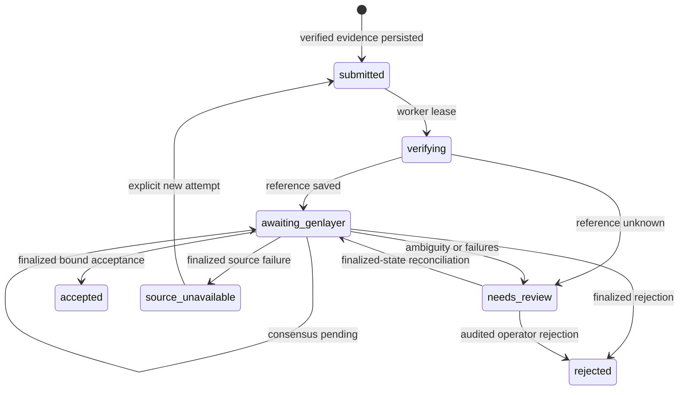

# Protocol specification

CHOG Evolution converts attributed participation into persistent NFT progression. This specification describes the current operator-managed MVP: Monad owns NFT state, GenLayer finalizes claim adjudication, and the API/worker commit progression in MongoDB. XP is not an onchain reward token.

The words **must** and **must not** describe implementation requirements and review invariants. They do not imply independent audit or formal verification. See [deployment.md](deployment.md) for deployed identities and [security.md](security.md) for residual trust.

## 1. Identity and version domains

An NFT profile is identified by `(mode, chainId, lowercased collectionAddress, decimal tokenId)`. `mode` is `demo` or `original_companion`. One profile retains progression and history for that NFT identity across ownership changes. A wallet is identified by its normalized EVM address.

GenLayer receives the profile identity as:

```text
chainId:lowercasedCollectionAddress:tokenId
```

| Version / identifier                 | Meaning                                                        |
| ------------------------------------ | -------------------------------------------------------------- |
| Logical claim ID                     | Durable application claim across retries                       |
| Attempt number and contract claim ID | One immutable evidence revision submitted to GenLayer          |
| Quest policy version                 | Rules for a particular quest, pinned when a claim is created   |
| Progression policy `3`               | Current wallet contribution allowance and progression behavior |
| Trait catalogue `1`                  | Trait definitions and equipment slots                          |
| Evidence schema `chog-evidence-v2`   | Public claim snapshot representation                           |
| Artifact schema `chog-artifact-v2`   | Published image metadata and provenance                        |
| Profile `version`                    | Increments for positive XP or an effective equipment change    |
| MongoDB schema `3`                   | Migration/index compatibility required by API readiness        |

A quest policy version is **not** necessarily `3`. Migration appends a version when its managed definition changes and preserves the policies used by existing claims.

Sources: [domain types](../packages/shared-types/src/index.ts), [progression](../packages/evolution-rules/src/index.ts), [migrations](../services/api/src/mongo.ts).

## 2. Authority

| Actor / system      | Authority                                                                        | Limit                                                                |
| ------------------- | -------------------------------------------------------------------------------- | -------------------------------------------------------------------- |
| Wallet holder       | Sign in, mint, submit evidence and control earned equipment while owning the NFT | Cannot authorize their own XP or make user context authoritative     |
| Monad RPC           | Supply receipts, canonical blocks, code and `ownerOf`                            | A generic transaction does not prove an unrelated campaign mission   |
| API                 | Verify authentication, ownership and attribution; freeze source and policy       | Capture accuracy remains an operator responsibility                  |
| Adjudicator owner   | Submit the selected policy and snapshot                                          | Submissions are permissioned, not user-controlled                    |
| GenLayer validators | Independently fetch the hashed snapshot and agree on policy application          | They fetch the API snapshot, not the original provider independently |
| Worker              | Reconcile final state and enforce reward constraints                             | Cannot award from a pending or mismatched decision                   |
| Database operator   | Maintain storage                                                                 | Controls offchain XP and artifact availability                       |
| Renderer            | Produce an image from committed traits                                           | Cannot decide eligibility, ownership or XP                           |

Consensus verifies the application-hosted snapshot and interpretation. It does not remove trust in the backend's RPC checks, original-source capture or database administration.

## 3. Authentication and ownership

1. The API issues a five-minute nonce challenge containing origin/domain, address, supported chain, issue time and expiry.
2. A valid EVM message signature must recover the requested address. Conditional nonce consumption prevents challenge replay from creating another session.
3. A seven-day `chog_session` cookie is HttpOnly, SameSite=Lax and Secure in production. Its token digest is stored server-side.
4. The signed proof is retained privately. Public evidence includes verified address/time and an opaque proof reference, not the signature or sign-in message.
5. Privileged profile operations verify `ownerOf` on the configured chain and collection. Saved owner fields or browser-selected addresses alone are insufficient.
6. Before accepted finalization, the worker rechecks ownership. Lost ownership produces `ownership_changed` and zero XP without rewriting the GenLayer decision.

Transfer preserves the NFT's existing profile, XP and history. The new owner authenticates and discovers/registers it before controlling equipment or submitting claims. Reward limits remain associated with the originating wallet. Ownership reads and MongoDB commits are separate; there is no atomic lock spanning Monad and MongoDB.

Sources: [auth](../services/api/src/auth-repository.ts), [chain checks](../services/api/src/config.ts), [profiles](../services/api/src/profile-repository.ts), [worker](../services/evolution-worker/src/index.ts).

## 4. Source verification

### Demo mint

The API checks a successful Monad Testnet transaction, configured collection, canonical block/receipt agreement, confirmation depth, mint `Transfer` from zero to the claimant, exact token and current ownership. Confirming a saved transaction hash again must not mint another NFT.

### X identity and posts

Linking retrieves a public profile bio containing a unique pending challenge code. The stable numeric account ID remains bound to the wallet after renaming or unlinking, preventing reuse by another wallet.

A post must resolve to the exact post ID and match the linked stable author ID. Capture preserves text and attached photos. Limits: four JPEG/PNG/WebP images, 10 MiB each, 20 MiB combined and 16 million pixels per image. Animation is rejected. Decoding validates integrity; adjudication does not interpret image contents.

### GitHub contribution

Capture retrieves public repository metadata, a commit and the README at that pinned commit. The README must attribute the claimant wallet. A repository identity is consumed globally as one contribution source; changing its commit, quest, profile or wallet does not create another source. Attribution alone does not establish substance. The maintained policy rejects forks, copied work, spam and generic promotion.

### Monad mainnet activity

Default scans inspect a bounded recent window for successful outbound contract interactions: claimant sender, calldata, deployed destination code, canonical receipt/block and configured confirmations. Incoming transfers, self-transfers, empty-data native transfers, reverted transactions and testnet activity do not qualify. Reviewed event targets select log scanning instead. A match is a candidate claim, not an award.

### Capture generations

Source text persists **before** resumable media work. Previews expire after ten minutes. Partial capture resumes the saved revision; expiry recapture creates a fresh generation. A transaction consumes a ready eligible preview only if owner, profile, quest, generation, request identity, policy and source hash still match.

Direct submission and source-unavailable retries also persist a revision before media work. Changed text must not be combined with images from an older revision. Preview eligibility means submission prerequisites passed; policy adjudication is separate.

Sources: [capture](../services/api/src/evidence-source.ts), [previews](../services/api/src/evidence-preview.ts), [media](../services/api/src/media-capture.ts), [scans](../services/api/src/scan-service.ts).

## 5. Evidence envelope

The API serializes the public snapshot once with `JSON.stringify` and computes:

```text
evidenceHash = "0x" + SHA256(UTF8(exactEvidenceText))
```

The envelope contains schema, policy kind, normalized wallet/NFT identity, public authentication provenance, ownership-check time, policy ID/version and verified source facts. Contribution context is `user_context_untrusted`; it cannot override rules or supply missing proof. Private wallet authentication material is separate.

Attempt 1 is `/v1/evidence/:claimId`; later attempts are `/v1/evidence/:claimId/attempts/:attempt`. Responses contain exact JSON text under `text/plain; charset=utf-8` with immutable cache semantics. The API caps snapshots at 19,500 characters; the contract accepts 20,000. Hash returned bytes directly: parsing and reserializing can change the digest.

The URL must be publicly reachable over HTTPS and its host allowed by the policy. The leader and validators independently fetch it and verify the supplied digest. An unavailable or changed body cannot authorize XP.

Sources: [claims](../services/api/src/claim-repository.ts), [evidence routes](../services/api/src/index.ts), [adjudicator](../genlayer/ClaimAdjudicator.py).

## 6. Lifecycle and finality



The contract outcomes are `accepted`, `rejected`, `needs_review` and `source_unavailable`. Transport/worker states separately describe progress. `unresolved` remains a shared compatibility type; it is not a positive award outcome.

The normal path requires a stored transaction reporting `FINALIZED` (stable SDK status `7`), without an explicit execution error, followed by `get_claim_decision` with `TransactionHashVariant.LATEST_FINAL`. `ACCEPTED` remains appealable and is insufficient.

| Field              | Required binding                                                                   |
| ------------------ | ---------------------------------------------------------------------------------- |
| `claim_id`         | Contract claim ID for the current immutable attempt                                |
| `claimant`         | Normalized submitting wallet                                                       |
| `profile_identity` | Exact chain/collection/token string                                                |
| `quest_id`         | Stored quest ID                                                                    |
| `policy_version`   | Pinned quest policy version                                                        |
| `evidence_hash`    | Attempt snapshot digest                                                            |
| `outcome`          | Supported contract outcome                                                         |
| `reason`           | Nonempty explanation                                                               |
| `xp`               | Safe nonnegative integer; accepted equals pinned reward, other outcomes equal zero |

The contract caps XP at its supplied maximum. The worker is stricter: partial accepted XP fails an exact-reward policy binding. Malformed, mismatched, pending, rejected and source-unavailable results create no positive ledger entry.

Explicit reconciliation of an ambiguous submission reads finalized state by its contract claim ID. A valid result receives `final-state:<contract>:<claim>`, a finalized-state reference rather than an invented transaction hash.

Sources: [finality adapter](../services/evolution-worker/src/genlayer.ts), [decision validation](../services/evolution-worker/src/index.ts).

## 7. Idempotency and retries

| Scope                                             | Protection                                                                |
| ------------------------------------------------- | ------------------------------------------------------------------------- |
| Wallet + idempotency key + intent hash            | Same request replays; changed intent returns conflict                     |
| Wallet + quest + submission key                   | Repeated source or once-only activity                                     |
| Quest + reward scope                              | Once-only or date-scoped participation                                    |
| Global contribution `source_key`                  | Same post/repository cannot be claimed across quests, profiles or wallets |
| Logical claim ID in XP ledger                     | At most one positive entry per claim                                      |
| Claim/source event in history, jobs and artifacts | No duplicate evolution/publication records                                |

Source uniqueness is consumed at claim creation, not only after a positive reward. Rejected or daily-capped sources cannot become eligible by changing wallet/profile.

Workers acquire expiring leases. Pending consensus schedules polling after 15 seconds without incrementing failure retries. Recoverable provider failures use bounded backoff; eight failures move a claim to review. Missing references after broadcast must be reconciled rather than blindly resubmitted. The design favors avoiding duplicate external effects over automatic liveness in that interval.

A finalized `source_unavailable` public contribution can be recaptured under a new numbered attempt while retaining previous evidence/decisions. Rejection is terminal. Unknown-reference review requests finalized-state reconciliation, not a new broadcast. Indexes and transactions establish at-most-once **committed rewards**, not exactly-once execution across external networks.

## 8. Reward authorization

| Kind              | Slug                     | Reward | Scope                                |
| ----------------- | ------------------------ | -----: | ------------------------------------ |
| `demo_mint`       | `demo-first-mint`        |  50 XP | Once per wallet                      |
| `bio_link`        | `verify-x-bio`           |  50 XP | Once per wallet and bound X identity |
| `public_evidence` | `ecosystem-contribution` |  75 XP | Wallet allowance at finalization     |
| `monad_activity`  | `monad-mainnet-explorer` |  25 XP | Once per wallet per UTC block date   |

Contribution allowance under progression policy 3:

1. If a positive contribution entry exists on the current UTC **finalization** date, award zero with `daily_cap`.
2. Otherwise, if less than an hour elapsed since the latest positive contribution reward, award zero with `cooldown`.
3. Otherwise, the exact policy reward, at most 75 XP, may be committed.

A reward at `23:30 UTC` prevents another at `00:05 UTC`; the next eligible time is `00:30 UTC`. Submission time and source publication date do not determine the contribution reward day.

Finalization writes a wallet reward revision before reading contribution entries, making concurrent profiles/leases contend on one wallet document. Ownership changes also reduce the amount to zero. Adjudication outcome and payload remain distinct from actual `xp_award` and `reward_reason_code`.

## 9. Atomic progression and equipment

A positive reward commits decision, finalized claim/attempt/event, one XP entry, profile progression, earned-trait provenance, history and an immutable artwork snapshot in a MongoDB transaction with majority write concern. Profile state is reread **inside** the transaction to avoid stale worker snapshots overwriting other rewards.

| Level | Stage       | Minimum XP |
| ----: | ----------- | ---------: |
|     1 | `hatchling` |          0 |
|     2 | `curious`   |         50 |
|     3 | `explorer`  |        150 |
|     4 | `veteran`   |        350 |
|     5 | `legend`    |        700 |

Bright eyes are a fixed feature at 50 XP. Trail scarf at 150 and star crown at 350 share the accessory slot; comet glow at 700 uses the aura slot. At most two distinct earned optional traits may be equipped, one per slot. New optional traits remain unequipped until chosen. Equipment requests require `expectedVersion` and idempotency; stale versions return 409.

An effective equipment change increments the profile version and creates a source event, history and deterministic artwork job, without XP or a GenLayer claim. Accepted zero-XP claims preserve decision/timeline but do not increment progression or create reward history/artwork.

## 10. Artwork and metadata

Jobs render their recorded snapshot, validate output, store PNG/JSON in GridFS and record content hashes/provenance. Publication binds to the source event and evolution version.

- Reward artwork uses `chog-trait-renderer-v2` without a Gemini key; with a key, it uses configured Gemini generation.
- Configured provider failures retry without undoing XP or replacing prior valid artwork. Failure does not imply successful Gemini publication.
- Equipment artwork always uses deterministic composition.
- Current publication requires the profile still having the target version. Older jobs may complete historical artwork but cannot replace newer current art.
- Published artifacts are immutable URLs; demo ERC-721 metadata is dynamic with short revalidation caching.
- Original collection metadata is read-only and cached separately; companion progression never calls its metadata setter.

GridFS remains operator-controlled storage. This release requires neither IPFS pinning nor an onchain progression commitment.

Sources: [artwork](../services/evolution-worker/src/artwork.ts), [composition](../packages/art-composition/src/index.ts), [demo metadata](../services/api/src/demo-metadata.ts).

## 11. Operational verification

JSON requests are limited to 64 KiB. Collections use bounded pagination; sources/media have fixed provider boundaries and size limits. Scans and discovery report partial coverage. A five-minute scheduled worker tick and external latency preclude instant finality.

Explicit migrations and API readiness verify MongoDB/schema 3. Readiness does not prove signer funding, provider reachability, consensus progress or image quota. Queue metrics and live acceptance establish those observations.

See [testing.md](testing.md), [operations.md](operations.md) and [security.md](security.md). Recorded live acceptance describes a particular run, not universal availability.
